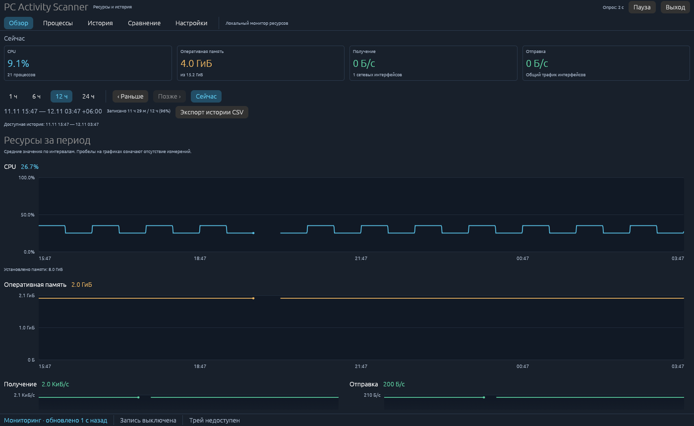
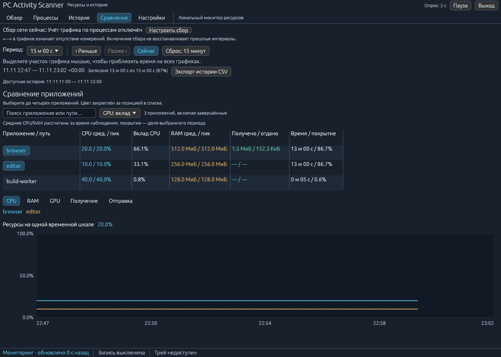

# PC Activity Scanner

Локальный монитор процессов на Rust/egui для Windows и Linux. Показывает нагрузку
CPU, память и общий сетевой трафик; на Linux — также доступные драйверу GPU-метрики
и трафик по процессам через NetHogs. Сохраняет историю ресурсов приложений
и позволяет сравнивать их за 1/6/12/24 часа. Данные остаются на компьютере.

[Скачать сборку](https://github.com/97Dmitry/pc_activity_scanner/releases/latest) ·
[Архитектура](docs/ARCHITECTURE.md) · [Спецификация](docs/SPEC.md) ·
[Ручная проверка](docs/QA_CHECKLIST.md) · [Разработка](CONTRIBUTING.md) ·
[Безопасность](SECURITY.md)



Пример графиков на проверочном 12-часовом наборе. Реальная история начинает
накапливаться после запуска программы.

## Готовые сборки

Откройте **[последний релиз](https://github.com/97Dmitry/pc_activity_scanner/releases/latest)**
и скачайте готовую программу из **Assets**:

| Система | Файл |
|---|---|
| Windows 11 x64 | `pc_activity_scanner-v0.3.1-windows-x86_64.exe` |
| Linux x86_64 | `pc_activity_scanner-v0.3.1-linux-x86_64` |
| Контрольные суммы | `SHA256SUMS.txt` |

Rust для запуска не требуется. Windows-сборка запускается двойным кликом.
Для Linux нужен рабочий стол X11/Wayland и графические библиотеки. Например,
Ubuntu/Kubuntu:

```bash
sudo apt update
sudo apt install libx11-6 libxcb-render0 libxcb-shape0 libxcb-xfixes0 libxkbcommon0 libwayland-client0 libgl1 libegl1 libxcursor1 libxi6 libxrandr2 libxkbcommon-x11-0
chmod +x pc_activity_scanner-v0.3.1-linux-x86_64
./pc_activity_scanner-v0.3.1-linux-x86_64
```

Также доступны комплекты с программой, README и лицензией:
`pc-activity-scanner-v0.3.1-windows-x86_64.zip` и
`pc-activity-scanner-v0.3.1-linux-x86_64.tar.gz`.
**Source code** внизу списка — исходники, а не готовые программы.

Релизы выходят по версиям (`v0.3.1`, `v0.2.1`, …), после успешных проверок и
сборок обеих ОС. Обычный push в `main` запускает CI без публикации snapshot.
Бинарники не подписаны; известные ограничения и объём проверок указаны в
[описании релиза](docs/releases/v0.3.1.md). Порядок публикации —
[RELEASING.md](docs/RELEASING.md).

## История и анализ

- **Обзор** объединяет текущие ресурсы и сохранённую историю.
- **История** показывает рейтинг приложений за выбранный период, средние и
  пиковые значения, время наблюдения и подробные графики приложения.
- **Сравнение** накладывает графики до четырёх приложений на общую шкалу.
- Периоды: 1/6/12/24 часа; можно перейти к предыдущему периоду и вернуться
  к текущему. В графиках есть оси времени и значения при наведении.
- История хранится между запусками в локальной SQLite-базе. По умолчанию —
  24 часа, в настройках — 1/3/7 дней, отключение записи и подтверждённая очистка.
- Исторический CSV экспортируется отдельно от текущей таблицы процессов.

История собирается только пока приложение запущено, в том числе при скрытии
в трей. Паузы, остановки и пропуски не заполняются выдуманными нулями.
Сразу после первого запуска 12 часов данных ещё нет — они накапливаются во
время работы. [Методика и ограничения](docs/HISTORY.md).



## Работа с монитором

- Сверху — CPU, использованная RAM и общий трафик интерфейсов. Историю CPU/RAM
  можно свернуть, чтобы освободить место таблице.
- Поиск принимает имя, PID или часть пути. Он применяется до группировки;
  числовые пороги и фильтры активности — к полученным строкам или группам.
- Нажатие на заголовок сортирует столбец, повторное нажатие меняет направление.
  Недоступные значения `—` остаются внизу при любом направлении.
- «GPU и итоги трафика» открывает дополнительные столбцы. В узком окне полная
  таблица прокручивается по горизонтали.
- Контекстное меню процесса позволяет скопировать имя, PID и путь.
- «Экспорт CSV» сохраняет **отображаемые строки в текущем порядке** в Downloads
  (либо текущий каталог, если Downloads не определён). Формат: UTF-8 с BOM,
  разделитель `;`, пустые ячейки для неизвестных метрик. Формулы экранируются,
  существующие экспорты не перезаписываются.
- «Пауза» останавливает обновление CPU/процессов. NetHogs и NVIDIA работают
  независимо; их выключение настраивается отдельно для NetHogs. После продолжения
  первая общая сетевая скорость усредняется за весь интервал, включая паузу.
- В настройках доступны интервалы 1/2/5 секунд и закрытие в трей. Если трей
  недоступен, закрытие окна завершает программу. Кнопка «Выход» завершает её явно.

## Какие метрики доступны

| Метрика | Linux | Windows |
|---|---|---|
| CPU/RAM системы и процессов | Да | Да |
| Общая скорость сети | Да | Да |
| Скорость и объём трафика по PID | NetHogs, по желанию | Пока нет |
| GPU и VRAM по PID | DRM/NVIDIA, зависит от драйвера | Пока нет |

`—` означает отсутствие данных, а не нулевую нагрузку. Общий трафик никогда не
выдаётся за трафик отдельных процессов. CPU нормализован по всем логическим
ядрам: 100% соответствует всей вычислительной мощности CPU.

Сессионный трафик — оценка по кадрам NetHogs. Кадры учитываются независимо от
интервала обновления таблицы; очередь ограничена 256 кадрами (около 8,5 минуты).
При переполнении статус сообщает о пропуске. Завершившиеся между опросами процессы
могут отсутствовать; NetHogs не передаёт время старта процесса, поэтому полностью
исключить неоднозначность очень быстрого повторного использования PID нельзя.
Старые скорости скрываются через семь секунд без нового кадра.

Общий трафик суммируется по интерфейсам без loopback; VPN и виртуальные интерфейсы
могут давать двойной учёт. Сумма процессов не обязана совпадать с общим трафиком.
Короткий график текущих процессов ограничен 120 измерениями; долговременная
история сохраняется отдельно. В базе хранятся имена/пути приложений и измерения
ресурсов. Приложение не собирает посещённые сайты, содержимое окон или пакетов
и не отправляет телеметрию.

## Включение NetHogs на Linux

GUI запускается обычным пользователем. Для захвата трафика используется отдельный
helper через Polkit. Бинарник helper и его родительские каталоги должны принадлежать
root и быть защищены от записи другими пользователями.

```bash
sudo apt install nethogs policykit-1
sudo install -D -o root -g root -m 0755 pc_activity_scanner-v0.3.1-linux-x86_64 /usr/local/bin/pc-activity-scanner
pc-activity-scanner
```

После установки включите «Трафик по процессам» в настройках. Появление системного
диалога авторизации ожидаемо. Отмена отображается в статусе метрик; для повторной
попытки выключите и включите настройку. Запуск GUI через `sudo` не требуется.
Бинарник из пользовательского каталога сборки намеренно не допускается к повышению
привилегий. Трей зависит от реализации рабочего стола, включая StatusNotifierItem
в KDE Plasma Wayland.

## Сборка из исходников

Toolchain закреплён в `rust-toolchain.toml` — Rust 1.95.0, rustfmt и Clippy.
Используйте rustup; зависимости закреплены в `Cargo.lock`.

Ubuntu/Kubuntu:

```bash
sudo apt install build-essential pkg-config libxcb-render0-dev libxcb-shape0-dev libxcb-xfixes0-dev libxkbcommon-dev libwayland-dev libssl-dev
cargo run --release --locked
```

Arch Linux:

```bash
sudo pacman -S --needed base-devel pkgconf libxcb libxkbcommon wayland openssl
cargo run --release --locked
```

Windows: установите rustup с MSVC toolchain и Visual Studio C++ Build Tools,
затем выполните `cargo run --release --locked` в PowerShell.

Для системной установки собранной Linux-версии используйте
`bash scripts/install-linux.sh`. Скрипт собирает release, затем через sudo
устанавливает бинарник и desktop-файл в `/usr/local`.

## Проверка

```bash
cargo fmt --all -- --check
cargo clippy --all-targets --locked -- -D warnings
cargo test --all-targets --locked
cargo build --release --locked
```

Проверка запуска окна без реального монитора (Linux):

```bash
sudo apt install xvfb xauth xdotool
LIBGL_ALWAYS_SOFTWARE=1 timeout 30s xvfb-run -a bash scripts/smoke-linux.sh
```

CI выполняет эти проверки на Linux и Windows; проверка окна через Xvfb выполняется
только на Linux. Она не заменяет ручную проверку Polkit, драйверов GPU, трея и
нативной Windows-сборки. WSL/headless-среда не является поддерживаемой целевой
платформой приложения.

## Лицензия

MIT — [LICENSE](LICENSE).
